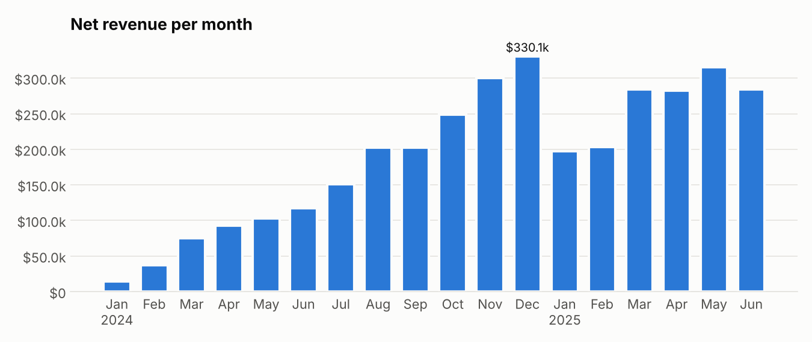
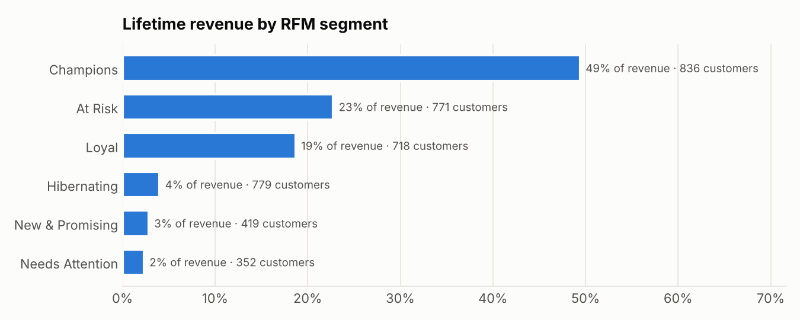
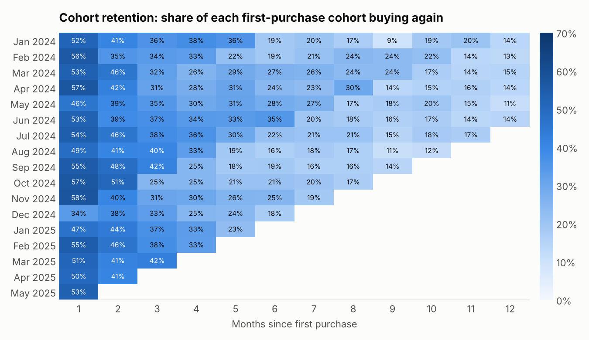
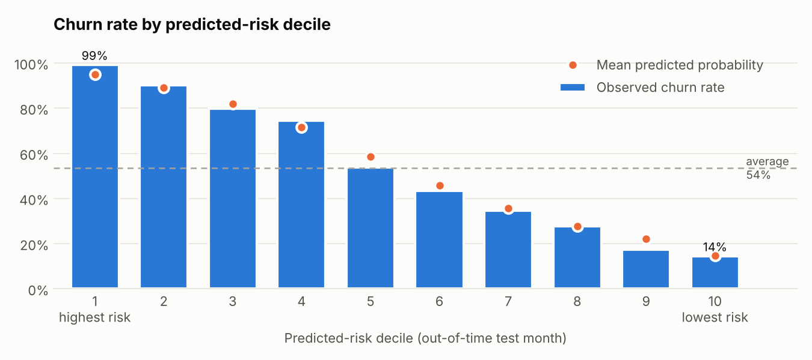
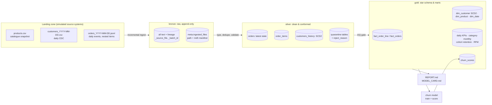
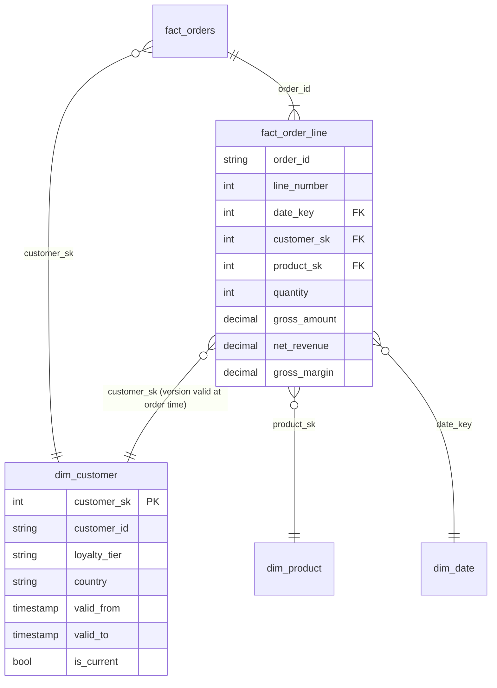

# ShopFlow: retail analytics lakehouse and churn prediction

[](https://github.com/Surbhit1508/Project-1/actions/workflows/ci.yml)


An end-to-end data platform for a (simulated) online retailer, built the way a production team
would build it, small enough to run on a laptop in **about 15 seconds** with a single command.

```
messy source files ─► bronze (raw, incremental) ─► silver (clean, SCD2) ─► DQ gate ─►
gold (star schema + marts) ─► DQ gate ─► churn model ─► scored customers ─► report
```

| | What this project demonstrates |
|---|---|
| **Data engineering** | Incremental, idempotent ingestion with a file manifest · medallion architecture · schema contracts · quarantining bad records instead of dropping them · deduplication and late-arriving / out-of-order events · **SCD Type 2** from a CDC stream · **point-in-time joins** · Kimball star schema with an unknown-member row · declarative **data-quality gates** that block bad data · a small DAG orchestrator with retries and run logging · CI, Docker, tests |
| **Analytics** | Daily KPI scorecard · category P&L · monthly **cohort retention** · **RFM segmentation** |
| **Data science** | **Leakage-safe** point-in-time feature engineering · out-of-time validation with a gap between train and test · a strong baseline to beat · model comparison · permutation importance · calibration · business framing (revenue at risk, call list) · model card |

---

## Quick start

```bash
git clone https://github.com/Surbhit1508/Project-1.git && cd Project-1
python -m venv .venv && source .venv/bin/activate
make install        # pip install -e ".[dev]"
make all            # generate data + run the whole pipeline
```

Or step by step:

```bash
shopflow generate                    # write ~25k orders of messy source data to data/landing/
shopflow run                         # ingest → silver → DQ → gold → DQ → train → score → report
shopflow run --only ingest_bronze    # incremental: re-running ingests nothing new
shopflow dq                          # re-run the data-quality suite
shopflow sql "SELECT * FROM gold.churn_scores LIMIT 10"
make test                            # 24 tests, ~10 s
```

No Docker? No cloud account? No problem: the warehouse is a single DuckDB file.
With Docker: `make docker`.

**Output:** [`reports/REPORT.md`](reports/REPORT.md) (business and pipeline report) and
[`reports/MODEL_CARD.md`](reports/MODEL_CARD.md). A sample run is committed so you can read
the results without running anything.

---

## Results (sample run)

| | |
|---|---|
|  |  |
|  |  |

**Churn model** (out-of-time test month, 2,424 active customers, churn = no order in the next 90 days):

| | ROC-AUC | PR-AUC | Precision in top 10% | Brier |
|---|---|---|---|---|
| Baseline: days since last order | 0.817 | 0.836 | 93.4% | n/a |
| Gradient boosting | 0.832 | 0.857 | 97.9% | 0.168 |
| **Logistic regression (selected)** | **0.837** | **0.869** | **99.2%** | **0.164** |

Customers in the top risk decile churn 99% of the time, the bottom decile 14%, and the predicted
probabilities track the observed rates (see the decile chart). Recency is a deliberately strong
baseline; the model's lift comes from **return experience**, acquisition channel and order
trend, which separate a quiet regular from a customer who is fading away.

---

## Architecture



### Star schema



---

## The data is messy on purpose

`shopflow generate` simulates customers with latent behaviour (purchase rhythm, category taste,
return propensity, deal-seeking, a churn hazard that rises after bad experiences) and then injects
the problems real pipelines face:

| Problem | How it is handled | Where |
|---|---|---|
| Same order delivered twice | `QUALIFY ROW_NUMBER()` on business key | `silver/03_orders.sql` |
| Order re-sent when it is returned (status change) | latest `updated_at` wins; `returned_at` kept for as-of logic | `silver/03_orders.sql` |
| Late-arriving events (in a later day's file) | partition-independent dedupe; event time ≠ file time | silver |
| Unparseable timestamp / missing customer id | `TRY_CAST` → **quarantine** with `reject_reason` | `silver.orders_quarantine` |
| Negative quantity / unknown product | line-level quarantine | `silver.order_items_quarantine` |
| `"COMPLETED "` vs `completed`, `ALICE@X.COM` | normalised, not rejected | silver |
| CRM re-sync that changes nothing | hash-based change detection, so no new SCD2 version | `silver/02_customers_history.sql` |
| Duplicate row in catalogue export | dedupe | `silver/01_products.sql` |
| Customer record not yet arrived | fact joins the **unknown member** (`customer_sk = 0`) instead of dropping revenue | `gold/02_dim_customer.sql` |

A test asserts that **every injected problem is quarantined exactly once** and that revenue is
conserved from silver through to every mart.

## Data-quality gates

`src/shopflow/quality.py` declares 26 checks (dbt-style: each is a query returning violating
rows). `error` checks stop the run *before* bad data is published to the next layer; `warn`
checks are logged. Every result lands in `meta.dq_results` for auditing.

* **Integrity:** uniqueness, not-null, accepted values, referential integrity
* **SCD2 validity:** exactly one current version per customer, no overlapping intervals
* **Reconciliation:** gold revenue = silver revenue to the cent; one fact row per valid order
* **Anomaly thresholds:** quarantine rate < 2% (a spike means an upstream incident)

## Churn model: avoiding the classic mistakes

| Pitfall | What this project does |
|---|---|
| Features computed with future data | Features use only orders **before** the cutoff, order status **as known at the cutoff** (a later return does not leak back) and the **SCD2 customer version valid at the cutoff**. A test deletes everything after the cutoff and asserts features are unchanged. |
| Random train/test split on time-series data | **Out-of-time** test month; every training label window closes **before** the test cutoff. |
| Evaluating on customers who left long ago | Population = customers active in the last 180 days; long-lapsed customers inflate every metric and are a win-back problem. |
| No baseline | Model must beat "days since last order", a strong heuristic in retail. |
| Metric that ignores the business | PR-AUC for model selection, precision/lift in the top decile (budget-constrained outreach), and **expected revenue at risk** to rank the call list. |

Details, caveats (seasonal drift, correlated snapshots, not causal) and next steps are in the
[model card](reports/MODEL_CARD.md).

---

## Project layout

```
src/shopflow/
├── generate.py           # behavioural simulator + data-problem injection
├── ingest.py             # bronze: incremental, idempotent, manifest-based
├── sql/silver/*.sql      # typing, dedupe, quarantine, SCD2
├── sql/gold/*.sql        # dimensions, facts (point-in-time), marts
├── quality.py            # declarative DQ checks + gating
├── pipeline.py           # DAG orchestrator (toposort, retries, skip-downstream, run log)
├── ml/features.py        # point-in-time feature SQL
├── ml/churn.py           # cutoff planning, training, evaluation, scoring
├── report.py             # REPORT.md, MODEL_CARD.md, charts
└── cli.py                # `shopflow` command
tests/                    # 24 tests: ingestion, transformations, DQ, DAG, leakage, ML
```

## Design decisions and trade-offs

* **DuckDB instead of a cloud warehouse.** Zero setup, columnar and fast, and the SQL ports
  almost unchanged to Snowflake/BigQuery/Databricks. The bronze → silver → gold split maps
  directly onto a lakehouse.
* **Full refresh of silver/gold.** At this scale a rebuild takes under 1 s and is trivially
  idempotent. At larger scale the order models would become incremental `MERGE`s keyed on
  `order_id` with a look-back window for late data; bronze is already incremental.
* **Hand-rolled orchestrator.** Keeps the repo dependency-free; each `Task` maps 1:1 to an
  Airflow/Dagster op, and the SQL files are already in a dbt-friendly layout.
* **Logistic regression won.** With well-designed features, the simpler, calibrated,
  explainable model edged out gradient boosting. The pipeline picks the winner on PR-AUC
  each run rather than hard-coding a choice.

## Roadmap

- [ ] Port SQL models to **dbt** (sources, tests, docs) and the DAG to **Airflow/Dagster**
- [ ] Incremental `MERGE` for silver orders with a late-data look-back window
- [ ] Track experiments and register models with **MLflow**; monitor drift per scoring run
- [ ] **Uplift modelling** with a randomised retention holdout (who will *respond*, not just who will leave)
- [ ] Streaming ingestion of order events (Kafka → bronze) and a Streamlit dashboard

---

All data is synthetic and generated locally; no real customer information is used.
Licensed under MIT.
