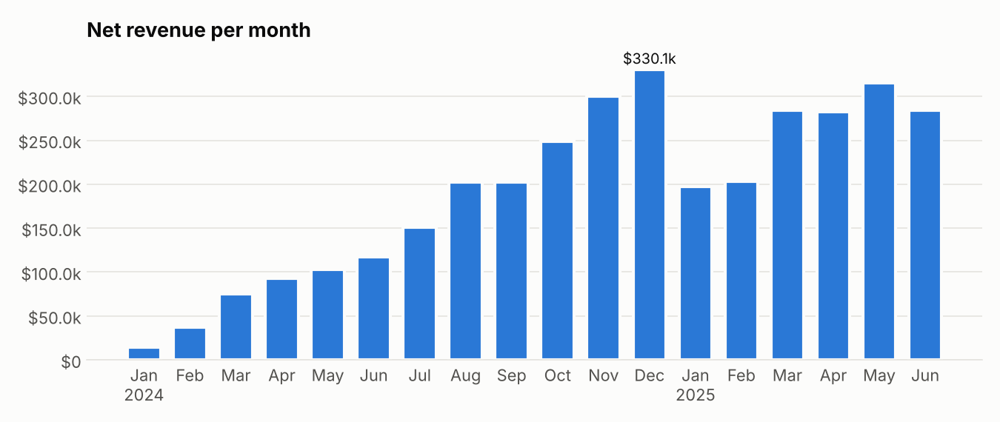
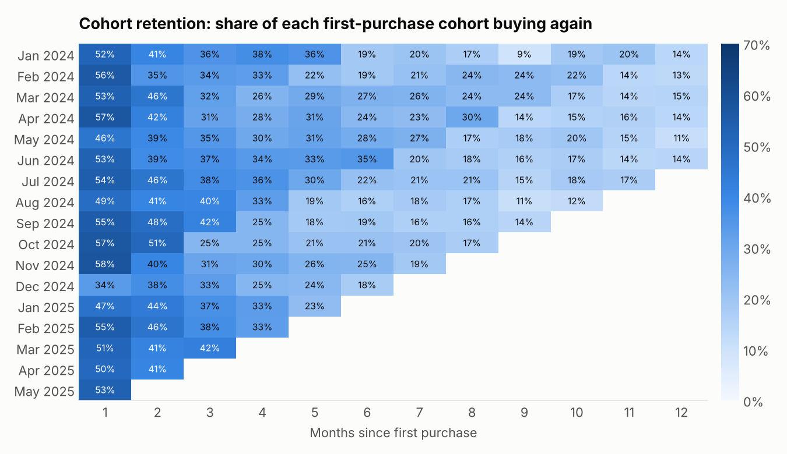
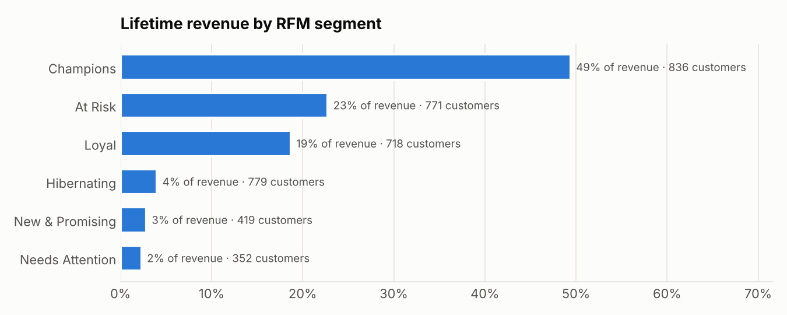
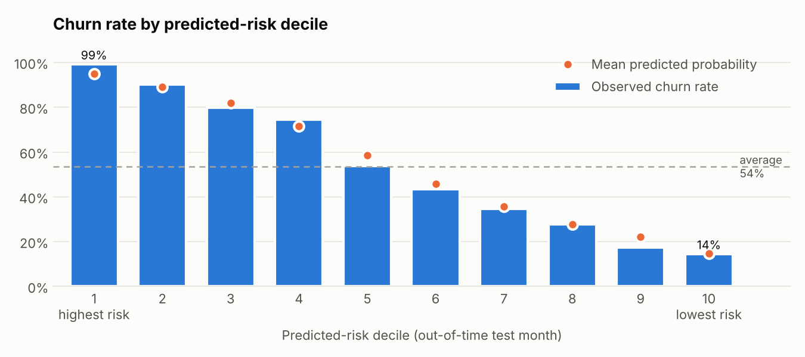

# ShopFlow: analytics report

_Generated 2026-11-23 15:18 from `data/warehouse.duckdb` (run `20261123T151840-efaadb`)._

## Headline numbers

| Metric | Value |
|---|---|
| Period covered | 04 Jan 2024 to 30 Jun 2025 |
| Net revenue | $3.44M |
| Gross margin | $1.38M (40.2%) |
| Orders (excl. cancelled) | 21,968 |
| Customers with a purchase | 3,875 |
| Average order value | $168.33 |
| Return rate | 6.9% |
| Net revenue, last 30 days vs prior 30 | $284.5k (-6.4%) |

### Category performance (last 12 months)

| category | net revenue (12 mo) | gross margin | units | avg line return rate |
|---|---|---|---|---|
| electronics | $1.63M | 37.8% | 5,546 | 6.1% |
| home | $526.3k | 40.6% | 5,263 | 7.1% |
| sports | $442.5k | 49.0% | 5,371 | 6.9% |
| apparel | $130.0k | 39.9% | 5,406 | 6.7% |
| beauty | $96.9k | 39.7% | 5,342 | 7.4% |
| books | $94.3k | 39.2% | 5,341 | 7.4% |
| grocery | $81.3k | 42.7% | 5,462 | 7.1% |

## Customers

## Churn risk

Model: **logistic regression**, trained on 12,265 customer-month snapshots (2024-05-01 to 2025-01-01) and evaluated out-of-time on 2,424 active customers at 2025-04-01 (churn = no order in the next 90 days). See [MODEL_CARD.md](MODEL_CARD.md).

| Test metric | Model | Recency baseline |
|---|---|---|
| ROC-AUC | 0.837 | 0.817 |
| PR-AUC | 0.869 | 0.836 |
| Precision in top 10% | 99.2% | 93.4% |
| Lift in top 10% | 1.85x | 1.74x |

### Current risk bands

| risk band | customers | avg churn prob. | revenue at risk (90d) |
|---|---|---|---|
| high | 959 | 0.814 | $44.1k |
| medium | 623 | 0.471 | $98.7k |
| low | 842 | 0.211 | $106.4k |

### Retention call list: highest expected revenue at risk

| customer_id | churn prob. | RFM segment | tier | days since last order | spend, last 90d | expected revenue at risk |
|---|---|---|---|---|---|---|
| C003619 | 0.63 | New & Promising | gold | 55 | $3,095 | $1,953 |
| C003482 | 0.41 | Champions | gold | 38 | $4,663 | $1,926 |
| C003289 | 0.7 | Needs Attention | gold | 87 | $2,160 | $1,501 |
| C003429 | 0.61 | Needs Attention | gold | 75 | $2,296 | $1,408 |
| C003143 | 0.48 | Champions | gold | 39 | $2,907 | $1,393 |
| C003435 | 0.47 | Loyal | gold | 27 | $2,862 | $1,341 |
| C002921 | 0.54 | Champions | gold | 28 | $2,413 | $1,297 |
| C001355 | 0.56 | Champions | gold | 42 | $2,167 | $1,222 |
| C002193 | 0.62 | Champions | gold | 43 | $1,907 | $1,173 |
| C003137 | 0.42 | Champions | gold | 36 | $2,739 | $1,147 |

## Pipeline health

### Data-quality gates

| layer | checks | passed | warnings | errors |
|---|---|---|---|---|
| silver | 16 | 16 | 0 | 0 |
| gold | 10 | 9 | 1 | 0 |

Non-passing checks:

| check_name | severity | failures | description |
|---|---|---|---|
| gold.mart_daily_kpis__no_gap_days | warn | 1 | every calendar day has at least one order |

### Records quarantined in silver

Rows that failed validation are kept with a reason instead of being silently dropped.

| entity | reason | rows |
|---|---|---|
| order lines | non_positive_quantity | 43 |
| orders | missing_customer_id | 33 |
| order lines | unknown_product | 18 |
| orders | unparseable_order_ts | 10 |

### Warehouse tables

| layer | table | rows |
|---|---|---|
| bronze | `bronze.customers` | 6,993 |
| bronze | `bronze.orders` | 24,468 |
| bronze | `bronze.products` | 151 |
| silver | `silver.customers_history` | 6,813 |
| silver | `silver.order_items` | 38,232 |
| silver | `silver.order_items_quarantine` | 61 |
| silver | `silver.orders` | 22,652 |
| silver | `silver.orders_quarantine` | 43 |
| silver | `silver.products` | 150 |
| gold | `gold.churn_scores` | 2,424 |
| gold | `gold.dim_customer` | 6,814 |
| gold | `gold.dim_date` | 544 |
| gold | `gold.dim_product` | 150 |
| gold | `gold.fact_order_line` | 38,232 |
| gold | `gold.fact_orders` | 22,652 |
| gold | `gold.mart_category_monthly` | 126 |
| gold | `gold.mart_cohort_retention` | 171 |
| gold | `gold.mart_customer_rfm` | 3,875 |
| gold | `gold.mart_daily_kpis` | 544 |
